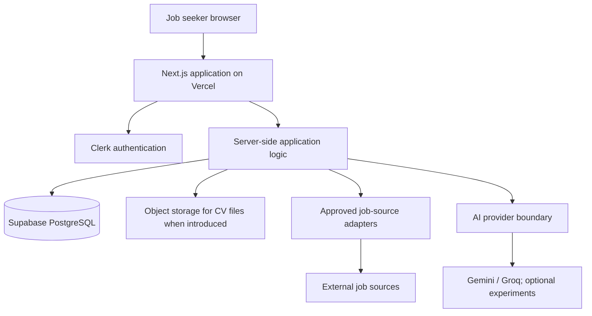

# Thungatha — Architecture

**Document status:** Working architecture authority for review  
**Version:** 1.0  
**Last updated:** 15 October 2026

## 1. Purpose and architectural direction

Thungatha is one full-stack Next.js App Router application, in one repository and one deployment, using a **modular monolith**. Job Discovery, CV Studio, and Job Tracking are separate product experiences with direct routes, not separate applications or microservices.

The architecture must deliver the approved product specification and milestones without creating speculative layers or infrastructure. Prefer the current project's established conventions and extend them only when a real feature requires it.

### Architectural rules

1. Product rules and ownership checks are enforced by server-side application code, not by the UI or AI.
2. Confirmed Profile data is authoritative; imported and AI-produced content remains unconfirmed until reviewed.
3. Unknown data stays unknown; don't turn missing evidence into a negative conclusion.
4. User-owned reads and writes must use server-derived identity and enforce ownership.
5. External providers and AI models are replaceable adapters, not sources of authority.
6. Keep one deployable application. Do not add microservices, a mandatory queue, or a generic agent framework without an approved, evidenced need.
7. Preserve the approved milestone sequence. Architecture supports the plan; it does not redefine it.
8. Distinguish current files from planned structure. A folder in the target map is not evidence that the feature has already been implemented.

## 2. Runtime and deployment

- **Application:** Next.js App Router, React, strict TypeScript.
- **Hosting:** Vercel, using supported Next.js server rendering, Route Handlers, and server-side execution.
- **Authentication:** Clerk; resolve the authenticated identity on the server.
- **Database:** PostgreSQL through Supabase, with version-controlled SQL migrations.
- **Database access:** Supabase JavaScript client and SQL/migrations following the existing repository pattern. Do not introduce Prisma or Drizzle by default.
- **Validation:** Zod for untrusted requests and structured external/AI output, consistent with existing code.
- **UI:** Material UI plus Tailwind CSS v4, following the existing theme and CSS-layer conventions.
- **Testing:** existing Vitest/React Testing Library and Playwright conventions, where present.
- **File storage:** Supabase Storage or another approved object-storage service when CV uploads/generated files are implemented. Do not depend on Vercel function local disk for durable files.
- **Local development:** Docker is optional, not a prerequisite.
- **Scheduled ingestion:** only add a Vercel-compatible scheduled invocation or another approved execution mechanism after source refresh needs, plan limits, and idempotency are defined.

Verify current platform limits and integration guidance before relying on function duration, scheduling, payload size, database connection, or provider quotas. Keep local, preview, and production secrets separate.

## 3. System context and trust boundaries



Trust boundaries:
- Browser input, URL parameters, IDs, profile data, and requested state changes are untrusted.
- External job data and AI responses are untrusted until normalized and validated.
- Authentication establishes identity; it does not by itself authorize access to every record.
- Privileged database credentials and provider keys remain server-side.
- Logs must not contain secrets, raw CVs, full job descriptions, or unnecessary personal information.

## 4. Logical layers and dependency rules

The app can organize code by feature and responsibility inside the existing `src/` tree. Do not create a separate package/class/folder for every box in a diagram.

- **Route and presentation layer:** App Router pages/layouts, route handlers, and React components. Compose screens and handle user interaction.
- **Application/use-case layer:** coordinates use cases, validation, authorization, persistence, provider calls, and state transitions.
- **Domain rules:** deterministic rules such as deduplication, matching classification, CV version rules, and application status transitions. Domain logic should not depend on Next.js, Clerk SDKs, database clients, or AI SDKs.
- **Infrastructure:** SQL/repository functions, Clerk identity integration, storage, job-source adapters, and AI-provider adapters.
- **Shared cross-cutting utilities:** authentication helpers, response/error conventions, schemas, environment validation, and logging. Do not turn `src/lib` into a catch-all for feature business logic.

Dependency rules:
1. UI components do not query PostgreSQL directly.
2. Route handlers validate requests, resolve the authenticated actor, call application logic, and translate outcomes into responses. Keep substantial business logic out of route handlers.
3. User IDs must be derived from the authenticated server identity, not accepted from the browser as authority.
4. Provider SDK imports stay inside the relevant adapter or explicitly approved integration boundary.
5. Keep module dependencies directional and avoid circular dependencies.
6. Reuse existing code after inspection; do not rebuild working authentication/profile foundation code just to fit a theoretical structure.

## 5. Agreed repository structure

The agreed target is a **feature-based modular monolith**. Keep Next.js routes and HTTP Route Handlers under `src/app/`; group feature-specific UI, browser-side code, types, utilities, and server-side business logic under `src/thungatha-features/<feature>/`. The directory name is intentionally explicit so Thungatha-owned feature code is easy to find in the project tree. Keep truly cross-feature UI under `src/components/` and shared infrastructure under `src/lib/` or `src/server/` according to the existing convention. Do not create both shared infrastructure locations for the same responsibility.

This is the **target structure**, not a claim that all target paths exist today. The first Jobs UI migration is complete: the public and authenticated discovery components, their CSS, and the authenticated discovery component test are now under `src/thungatha-features/jobs/ui/`. Job server logic remains under `src/lib/jobs/` and `src/app/api/jobs/` for now. Continue the migration incrementally, preserving routes/API contracts and behavior, and verify each coherent move.

```text
thungatha/
├── README.md
├── AGENTS.md
├── IMPLEMENTATION-PLAN.md
├── DECISIONS.md
├── folder-structure.txt                # Agreed target map and migration notes
├── docs/
│   ├── PRODUCT-SPECIFICATION.md
│   ├── ARCHITECTURE.md
│   └── PUBLIC-JOB-DISCOVERY-IMPLEMENTATION-PLAN.md
├── milestones/                         # Existing milestone records remain in place
├── public/
│   └── brand/
├── scripts/
├── src/
│   ├── app/                            # URL routing and HTTP endpoints
│   │   ├── api/
│   │   │   ├── jobs/
│   │   │   ├── profile/
│   │   │   └── internal/
│   │   ├── page.tsx                    # Public Job Discovery at /
│   │   ├── jobs/page.tsx               # Authenticated Job Discovery at /jobs
│   │   ├── cv-studio/page.tsx
│   │   ├── applications/page.tsx        # Current route; product route decision remains in spec
│   │   ├── profile/page.tsx
│   │   ├── account/page.tsx
│   │   ├── sign-in/
│   │   ├── sign-up/
│   │   ├── layout.tsx
│   │   └── globals.css
│   ├── features/                       # Feature-owned implementation
│   │   ├── jobs/
│   │   │   ├── ui/
│   │   │   │   ├── jobs-discovery.tsx
│   │   │   │   ├── jobs-discovery.css
│   │   │   │   ├── jobs-discovery.test.tsx
│   │   │   │   ├── public-job-discovery.tsx
│   │   │   │   └── public-job-discovery.css
│   │   │   ├── client/                 # Target location; not created until code is moved
│   │   │   │   └── jobs-api.ts
│   │   │   ├── types/job.ts            # Target location; not created until code is moved
│   │   │   └── utils/job-utils.ts      # Target location; not created until code is moved
│   │   ├── cv-studio/
│   │   ├── job-tracking/
│   │   └── profile/
│   ├── server/                         # Only if shared server infrastructure needs a clear home
│   │   ├── auth/
│   │   ├── database/
│   │   └── http/
│   ├── components/                     # Shared UI, layout, brand, theme
│   │   ├── auth/
│   │   ├── layout/
│   │   ├── brand/
│   │   ├── theme/
│   │   └── ui/
│   ├── lib/                            # Existing cross-cutting helpers/infrastructure
│   │   ├── auth/
│   │   ├── http/
│   │   ├── supabase/
│   │   └── theme.ts
│   ├── styles/
│   ├── test/
│   ├── theme/
│   └── proxy.ts
├── supabase/
│   └── migrations/
├── e2e/
├── vitest.config.mts
├── playwright.config.ts
├── package.json
└── tsconfig.json
```

### Structure interpretation and migration constraints

- The tree is a **target map**, not an inventory of current files. The current repository tree is recorded in `folder-structure.txt`; update that document when the actual tree changes.
- Keep all existing routes, API paths, request/response shapes, authentication boundaries, and business behavior unchanged during structural-only changes.
- Do not create empty feature folders or placeholder implementation files just to match the diagram. Add a folder when real code is ready to move into it.
- Keep test files alongside existing implementations unless a specific test organization need is demonstrated.
- Keep CSS with its owning feature when it is feature-specific. Shared design tokens and cross-feature styling remain in the existing shared styles/theme locations.
- Keep `src/app/api/**/route.ts` files as thin HTTP adapters over time; move business logic only when an isolated, tested extraction can preserve the endpoint contract.
- `src/thungatha-features/jobs/` should initially contain only the two discovery experiences and genuinely shared code. Do not force public and authenticated pages into one large component.
- Public discovery can browse/search/inspect jobs. User-owned saved/dismissed state, activity, and job tracking remain authenticated and server-authorized.
- Job Tracking is a private feature. CV Studio may have a public introduction/preview and authenticated authoring, but this is a product access rule, not a requirement to duplicate its implementation.
- The target uses the existing stack: Next.js App Router, React, TypeScript, Clerk, Supabase, MUI and Tailwind CSS v4. Do not add another UI framework or ORM as part of the folder migration.

## 6. File and folder guide

| Path | Responsibility |
|---|---|
| `src/app/` | Next.js routes, page/layout composition and API Route Handlers |
| `src/thungatha-features/jobs/ui/` | Public and authenticated discovery experiences plus shared job UI only where useful |
| `src/thungatha-features/jobs/client/` | Browser-side API callers/hooks shared by both discovery experiences where behavior matches |
| `src/thungatha-features/jobs/types/` | Shared job and feed response types |
| `src/thungatha-features/jobs/utils/` | Shared pure helpers such as safe URL and display formatting |
| `src/thungatha-features/jobs/server/` | Future home for extracted job use cases/data access when a tested refactor warrants it; do not create empty layers |
| `src/thungatha-features/cv-studio/` | CV Studio feature code when M4 requires it |
| `src/thungatha-features/job-tracking/` | Authenticated application lifecycle code when M5 requires it |
| `src/components/ui/` | Generic buttons, modals, skeletons, toasts and other cross-feature primitives |
| `src/components/layout/` | Shared application shells and navigation |
| `src/lib/auth/`, `src/lib/http/`, `src/lib/supabase/` | Existing cross-cutting helpers; retain until a concrete reason to relocate them is agreed |
| `src/lib/jobs/` | Current job ingestion/provider/search implementation; remains in place until a separately verified extraction |
| `supabase/migrations/` | Version-controlled database schema changes |
| `e2e/` | Playwright user journeys |
| `src/**/*.test.ts(x)` | Existing colocated unit, API and component tests |

Feature-specific business rules must not drift into generic shared utilities. Avoid maintaining two competing locations for the same implementation.
 
## 7. Product module boundaries

| Module/experience | Owns | Does not own |
|---|---|---|
| Job Discovery | Normalized job catalogue, source provenance, search/filter/detail, save/dismiss, availability status | Application lifecycle, CV versions, Profile-based scoring in M1 |
| Profile | Confirmed professional facts, import drafts, confirmation, profile history | Silent AI-driven edits |
| Matching | Requirement extraction, evidence mapping, deterministic scoring, explanation and stale-state | Owning job listings or CV versions |
| CV Studio | Master CV and tailored versions, recommendation, review, preview, comparison, export | Editing Profile silently; application status history |
| Job Tracking | Actual application records, statuses/history, submitted-material reference, contacts, interviews, notes, follow-ups | Job-source catalogue ownership or CV authoring |
| Account | User preferences and account-level settings defined in M6 | Duplicating Clerk identity or feature data |

Job Tracking links to the exact CV version or submitted-material snapshot used for an application. CV Studio remains the owner of CV versions. A user can record an externally sourced application in Job Tracking without first creating a Job Discovery catalogue record.

## 8. Data access, authentication, and ownership

- Resolve the authenticated user on the server through Clerk integration.
- Treat identity and record authorization as separate checks.
- Never accept a client-provided `userId` as proof of ownership.
- Apply ownership constraints to every user-owned read and write.
- Use Supabase/PostgreSQL Row Level Security where appropriate to the chosen connection and authorization pattern.
- Keep privileged credentials server-only. Never serialize them into client props or client bundles.
- Validate requests at runtime using Zod or the established project schema pattern.
- Keep migrations version-controlled and avoid untracked manual production schema changes.
- Test cross-user isolation and unauthorized access for each new user-owned resource.

The existing profile API/repository/migration provide a starting example. Inspect their implementation before copying the pattern to other features.

## 9. Job-source integrations

Each approved job source should sit behind a small server-side adapter with a normalized internal output. Source adapters should:
- preserve source-specific identifiers and original discovery/application URLs;
- validate and normalize provider responses;
- respect terms, attribution, quotas, and approved access methods;
- use bounded requests, timeouts, and explicit error handling;
- be safe to retry and idempotent where ingestion is repeated;
- avoid mass-marking listings unavailable because a provider temporarily failed;
- retain useful provenance and refresh history.

A source list found in research is not automatically approved. Confirm source-specific requirements during the appropriate M1 checkpoint. Do not add an unapproved source simply because it is technically convenient.

## 10. AI provider boundary

Use a provider-independent server-side interface only for concrete tasks that need AI. Gemini is the initial primary option; Groq is an alternative for supported tasks. Camber and Ollama remain optional experiments, not required runtime dependencies.

- Validate all structured output.
- Apply timeouts and bounded retries only for transient failures.
- Treat output as a suggestion and never as authorization or unquestioned truth.
- Keep keys server-side.
- Avoid sending CVs or unnecessary personal data during M1.
- Ensure ingestion, deterministic filtering, persistence, and user actions still work when AI is disabled.
- Do not build a generic agent framework for the MVP.

## 11. CV files and storage

When CV upload and export are implemented, use durable object storage approved for the project, such as Supabase Storage if suitable. Decide file type/size limits, access policies, signed URLs, retention, deletion, and privacy behaviour before release. Do not rely on the function's local filesystem for durable storage.

## 12. UI and navigation architecture

- `/` is the public landing page.
- `/jobs`, `/cv-studio`, and `/job-tracking` are the three primary authenticated experiences.
- `/profile` and `/account` are supporting areas.
- `/sign-in` and `/sign-up` provide authentication.
- Each primary experience must handle direct entry and missing prerequisites gracefully.
- Use the current shared theme and design tokens rather than creating feature-specific competing design systems.
- Keep only one dominant glow/high-emphasis action per screen, consistent with the supplied design direction.
- Use the existing MUI + Tailwind v4 approach consistently; do not introduce a second component system without approval.
- Inspect existing dashboard/auth-shell references before removal or migration.

## 13. Testing and operational visibility

For each checkpoint, select tests that prove the changed behaviour:
- unit tests for deterministic rules and state transitions;
- API/integration tests for validation, persistence, provider failures, and ownership;
- component tests for loading/empty/error/validation and accessible interactions;
- Playwright for critical end-to-end user journeys and responsive behaviour.

At release, run the available formatting, lint, type-check, test, build, browser, accessibility, privacy/security, and performance checks. Record actual results; never fabricate a passing check. Avoid adding telemetry that records raw CV content or unnecessary personal information.

## 14. How to change this architecture

Change the architecture when there is a demonstrated technical need, a product requirement that cannot be met with the current design, or an external constraint that invalidates an assumption.

Before making a structural change:
1. identify the requirement or evidence;
2. describe the alternatives and trade-offs;
3. identify effects on approved milestone scope and acceptance criteria;
4. update `DECISIONS.md` where appropriate;
5. obtain user approval before changing a locked scope or sequence.

Routine implementation details can evolve within these boundaries, but do not silently alter the approved roadmap or convert an open decision into a settled one.

## 15. Relationship to other documents

- `docs/PRODUCT-SPECIFICATION.md` defines what the product must do and the user-facing rules.
- `IMPLEMENTATION-PLAN.md` defines the cross-milestone sequence, dependencies, progress, and overall acceptance.
- `milestones/<folder>/<file>.md` defines detailed work, checkpoints, tests, evidence, and milestone acceptance.
- `DECISIONS.md` records rationale, status, and open decisions.
- `AGENTS.md` tells AI coding agents how to work safely and consistently.
- `README.md` explains setup, environment configuration, commands, and how to navigate project documentation.

When a conflict appears, identify it and ask for review instead of guessing. The feature-based folder structure and incremental Jobs migration approach are confirmed architecture decisions. Placing a target path in the map does not mean code has already moved there or that unresolved product/source-provider decisions are approved.
